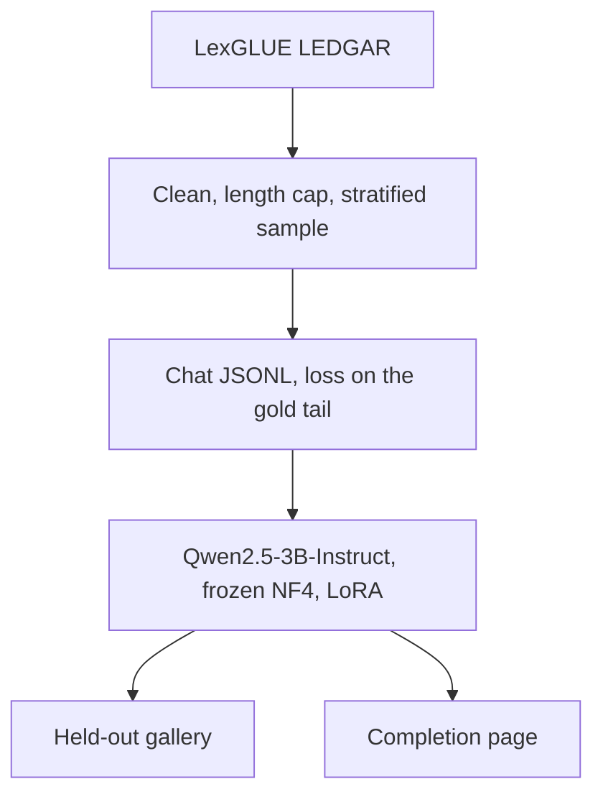

# Architecture

ClauseDraft adapts a 3B instruct model to the wording of US commercial contract clauses. A user supplies a clause type and the start of a clause. The adapter continues it. Comparison against the untouched base model is the measure of whether the adapter picked up the domain.

The gallery scores the base model, then the adapter. The page loads one of those models. An 8 GB GPU holds one 3B model at a time.

## Why these settings

The training box is an 8 GB laptop GPU. QLoRA on a 3B model fits when the sequence length stays at 1024, the batch size is 1, and gradients are checkpointed. Rank 16 on every attention and MLP projection is the usual capacity for domain style, without training the full weight set. If the 3B run runs out of memory, `model.fallback_name` switches the same config to Qwen2.5-1.5B-Instruct.

LEDGAR provisions are already one clause each, with a type label. That maps onto the product: the prompt names the type, the user text is a prefix, and the target is the rest of the provision. The official test split stays out of training.

## What the code does today

`clausedraft.config.load_config` reads `configs/default.yaml` and rejects a broken prefix split, an empty model id, or a non-positive LoRA rank. `scripts/check_gpu.py` loads a tiny NF4 linear layer on CUDA and runs one forward. That checks the Blackwell kernel path before any model download.

`scripts/prepare_corpus.py` loads LEDGAR, cleans it, and writes `data/processed/provisions.jsonl`. Exact copies prefer the test split over train, so a clause that leaked into both does not remain in the training rows. The train cap is stratified by clause type.

`scripts/build_jsonl.py` turns each remaining provision into a chat example. The user message names the clause type and gives a prefix of about 40 percent of the words. The assistant message is the rest of the clause, and that is the only text the loss will cover. Train and validation are written for the trainer. The test file is held out. A leakage check drops any train or validation row that still shares its full text or its gold tail with the test split. Details and the citation are in [data.md](data.md).

`scripts/train.py` loads that base model in 4-bit, attaches the LoRA adapter from the config, and trains with loss only on the assistant tokens. The script writes the adapter, `loss.json`, a loss curve, and a model card. It does not write the frozen base weights. A one-step smoke run is `--limit 32 --max-steps 1`. The full epoch is the same command on a free Colab GPU, via [notebooks/train_colab.ipynb](../notebooks/train_colab.ipynb), with validation every 50 steps on the first 128 validation rows. See [training.md](training.md).

`scripts/eval_generate.py` takes eight held-out test prompts and continues each one with the base model, then again with the adapter. Decoding is greedy. The gallery reports word overlap with the gold tail, a contract-register check, and the gold-tail loss. The two models are not loaded together. See [eval.md](eval.md).

`scripts/complete.py` is the live command. It checks the clause type against the 100 LEDGAR labels, loads the base model in 4-bit with an optional adapter, and continues the prefix. `greedy` matches the gallery. `draft` samples. See [inference.md](inference.md).

`scripts/serve.py` is the same drafter behind HTTP. `POST /api/complete` takes a clause type and a prefix. The page at `/` is static files under `web/`, served by that process. An empty prefix is caught in the page. An unknown type or preset is a 400 from the same checks the command uses. The section under the form is the saved gallery from `docs/gallery.md`, not a second live model. See [api.md](api.md).

Checkpoints, the downloaded corpus, and `outputs/` are gitignored. The adapter is a training artifact, not source.
